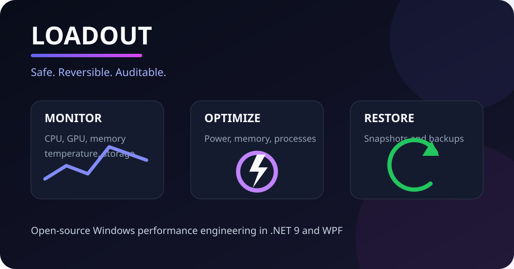

<div align="center">

# Loadout

**A transparent Windows performance toolkit built around safe, reversible changes.**

[](https://github.com/Zedoww/loadout/actions/workflows/ci.yml)
[](https://github.com/Zedoww/loadout/actions/workflows/codeql.yml)
[](https://github.com/Zedoww/loadout/releases)
[](LICENSE)
[](https://dotnet.microsoft.com/)



</div>

Loadout monitors a Windows PC and applies gaming-focused optimizations without
turning the system into a black box. Before changing power, registry, process,
or cleanup state, it records enough information to restore the original state.

## Engineering principles

- **Reversible by design:** every system mutation has a corresponding restore path.
- **Preview before action:** cleanup targets expose their scope, size, and risk level.
- **No telemetry:** Loadout performs no analytics or background network calls.
- **Auditable:** system operations live in a UI-independent core covered by tests.
- **Failure-aware:** operations return explicit results and emit structured local logs.

## Capabilities

| Area | What it provides | Safety model |
| --- | --- | --- |
| Monitoring | CPU, GPU, memory, temperature, storage, and system inventory | Read-only |
| Surge | Coordinated power, memory, and background-process optimization | Snapshot and restore |
| Processes | Resource-heavy process discovery and suspend/resume | Reversible |
| Tweaks | Curated Windows and gaming registry settings | Original values backed up |
| Cleanup | Categorized preview of temporary files, caches, and Recycle Bin | Risk labels and confirmation |

State, backups, and rolling logs are stored under `%APPDATA%\Loadout\`.

## Architecture

```text
Loadout.sln
`-- src/
    |-- Loadout.Core/        Monitoring, optimization, cleanup, and backup logic
    |-- Loadout.App/         WPF application using MVVM and dependency injection
    `-- Loadout.Core.Tests/  xUnit coverage for reversible business operations
```

The application uses .NET 9, WPF-UI, CommunityToolkit.Mvvm, dependency
injection, and Serilog. The core project has no WPF dependency, which keeps the
system logic independently testable.

## Build and run

Requirements: Windows 10 or 11 and the [.NET 9 SDK](https://dotnet.microsoft.com/download/dotnet/9.0).

```powershell
git clone https://github.com/Zedoww/loadout.git
cd loadout
dotnet restore Loadout.sln
dotnet build Loadout.sln --configuration Release --no-restore
dotnet test Loadout.sln --configuration Release --no-build
dotnet run --project src/Loadout.App
```

Loadout requests administrator privileges because Windows requires elevation
for power-plan, registry, process, restore-point, and hardware-sensor access.

## Install a release

Download the ZIP and matching SHA-256 checksum from
[GitHub Releases](https://github.com/Zedoww/loadout/releases). Verify the archive
before extracting it:

```powershell
Get-FileHash .\loadout-win-x64.zip -Algorithm SHA256
Get-Content .\loadout-win-x64.zip.sha256
```

Release builds are currently unsigned. Windows may therefore display a
SmartScreen warning. The release workflow and source remain public so that the
binary can be reproduced locally.

## Quality and security

- CI restores, builds, and runs the complete test suite on every pull request.
- CodeQL analyzes C# changes and dependencies are tracked by Dependabot.
- System-changing services are tested with injected paths and controlled state.
- Security reports are handled according to [SECURITY.md](SECURITY.md).

## Roadmap

- Per-game optimization profiles
- In-game performance monitoring
- Reversible startup and service management
- Historical dashboard charts
- Signed Windows release packages

## Contributing

See [CONTRIBUTING.md](CONTRIBUTING.md). Every contribution that changes system
state must include a tested restore path.

## License

[MIT](LICENSE) - copyright Allan Seddi and contributors.
